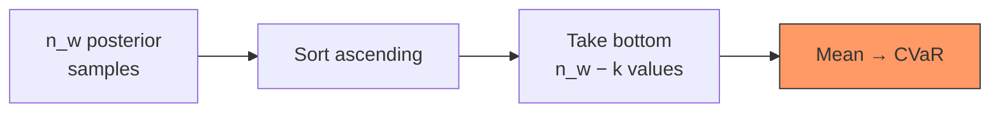
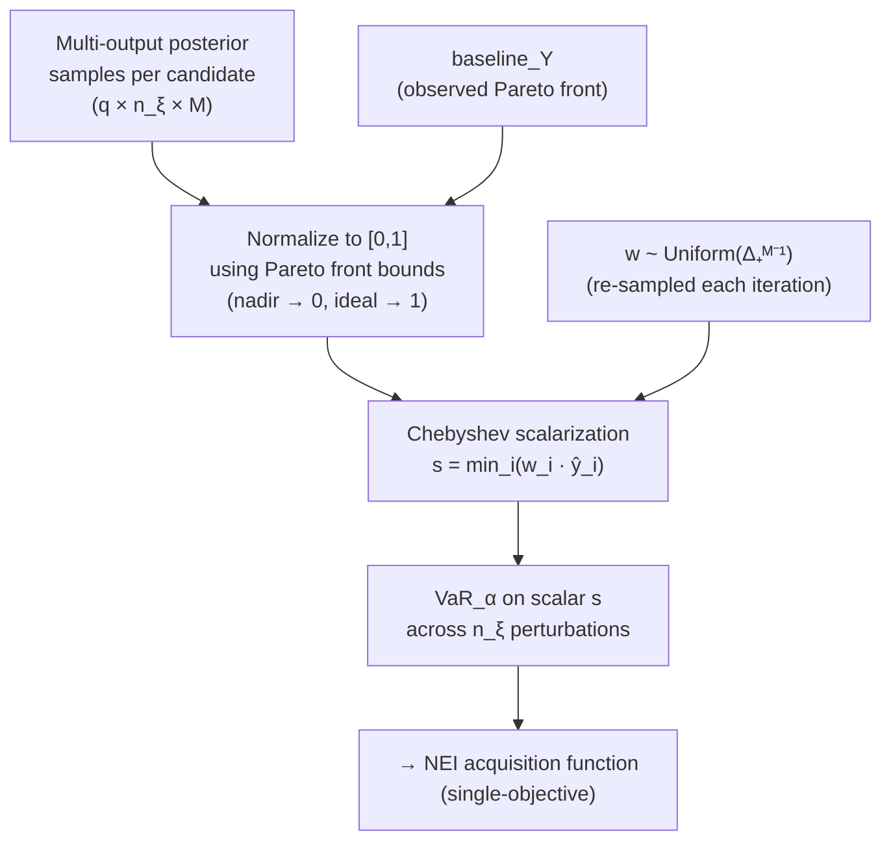
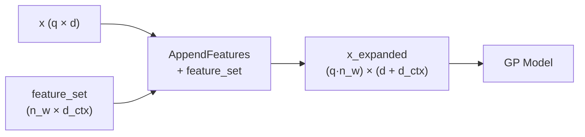
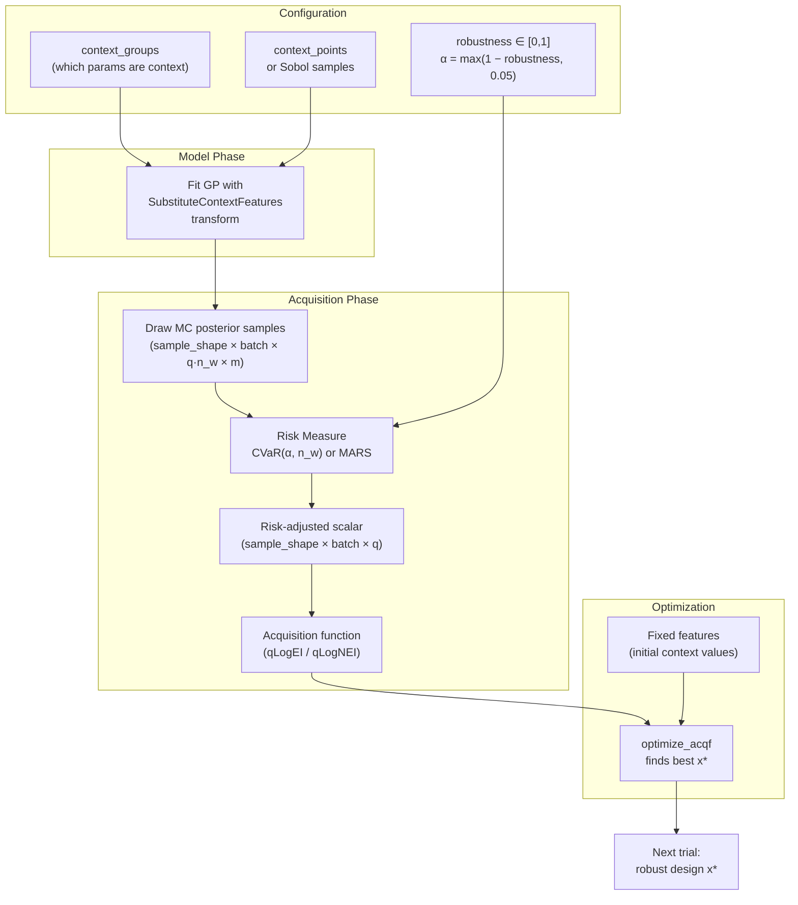
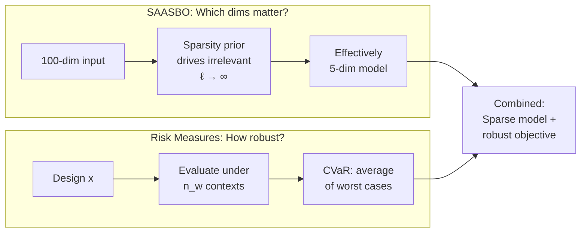
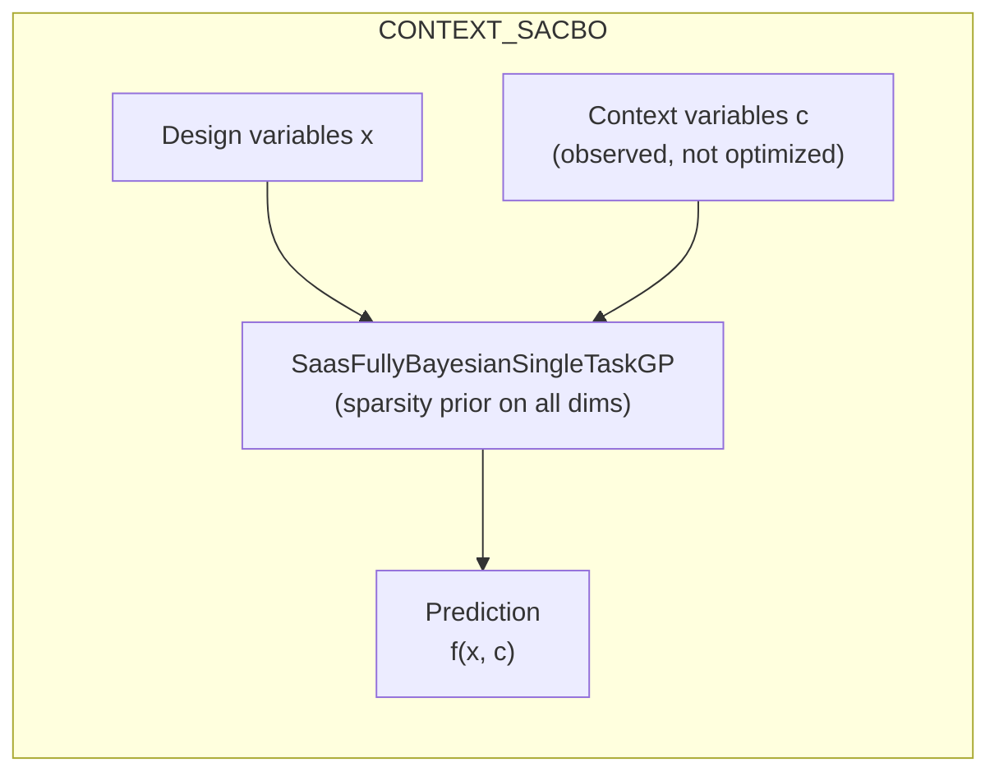
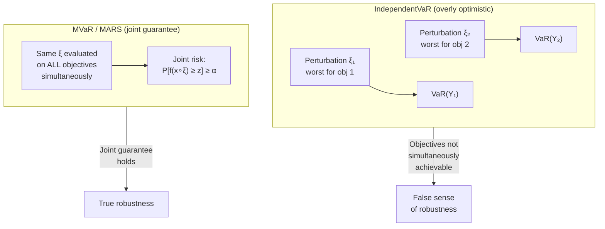
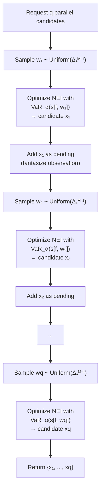
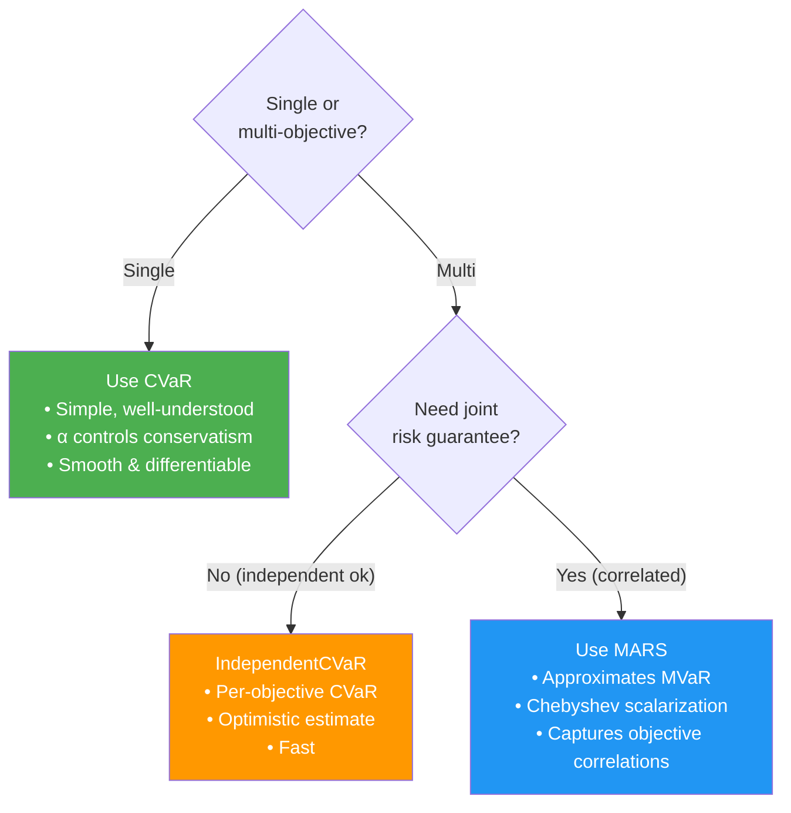

# Risk Measures in Bayesian Optimization

## Overview

Risk measures transform a distribution of outcomes into a single scalar that captures
**how bad things can get** under uncertainty. In BO, the uncertainty comes from
environmental/context variables (manufacturing tolerances, operating conditions, etc.)
that the optimizer cannot control.

---

## 1. Single-Objective Risk Measures

### Value-at-Risk (VaR)

The largest value that the objective exceeds with probability $\geq \alpha$.

$$\text{VaR}_\alpha\bigl[f(\mathbf{x} \diamond \boldsymbol{\xi})\bigr] = \sup\bigl\{z \in \mathbb{R} : P\bigl[f(\mathbf{x} \diamond \boldsymbol{\xi}) \geq z\bigr] \geq \alpha\bigr\}$$

In discrete MC approximation with $n_w$ samples sorted descending:

$$\text{VaR}_\alpha \approx Y_{(\lceil \alpha \, n_w \rceil)} \qquad \text{(the } \lceil \alpha \, n_w \rceil\text{-th largest value)}$$

- **$\alpha = 0.8$**: the value exceeded by 80% of scenarios — higher $\alpha$ is *more* conservative.
- A single point estimate — tells you *where* the bad tail starts, not *how bad* it gets.

> **Convention note:** The paper (Daulton et al., 2022) defines $\alpha$ as a confidence level
> where higher $\alpha$ = more conservative. BoTorch's internal `alpha` parameter is inverted:
> higher `alpha` = *less* conservative (fraction of samples to keep). foamBO maps between
> them via `alpha_botorch = max(1 - robustness, 0.05)`.

### Conditional Value-at-Risk (CVaR)

The **average** outcome in the worst $(1 - \alpha)$ fraction of scenarios.

$$\text{CVaR}_\alpha(Y) = \frac{1}{n_w - k} \sum_{i \in \text{worst}} Y_i, \qquad k = \lceil n_w \cdot \alpha \rceil$$



- $\alpha \to 1$ → nearly risk-neutral ($\approx$ Expectation)
- $\alpha \to 0$ → extremely conservative ($\approx$ WorstCase)
- $\text{CVaR}_\alpha \leq \text{VaR}_\alpha$ always — it captures the *severity* of the tail, not just its boundary.

### Comparison Table

| Measure      | Formula                                                        | Conservatism         | Differentiable? |
|-------------|----------------------------------------------------------------|---------------------|-----------------|
| Expectation | $\frac{1}{n_w}\sum_i Y_i$                                      | None (risk-neutral) | ✓               |
| VaR         | $\sup\{z : P[Y \geq z] \geq \alpha\}$                          | Moderate            | ✗ (step fn)     |
| CVaR        | $\frac{1}{(1-\alpha)\,n_w}\sum_{i \in \text{worst}} Y_i$       | High                | ✓ (smooth)      |
| WorstCase   | $\min(Y_1, \dots, Y_{n_w})$                                    | Maximum             | ✗               |

> **Why CVaR is preferred:** differentiable + captures tail severity. VaR only marks the
> boundary; CVaR tells you what happens *beyond* it.

---

## 2. Multi-Objective Risk Measures

When optimizing multiple objectives simultaneously, risk measures become set-valued.

### IndependentCVaR

Applies CVaR **separately** to each objective.

$$\text{IndependentCVaR}_\alpha(\mathbf{Y}) = \bigl[\text{CVaR}_\alpha(Y_1),\; \text{CVaR}_\alpha(Y_2),\; \dots,\; \text{CVaR}_\alpha(Y_m)\bigr]$$

- Simple but **overestimates robustness** — ignores correlations between objectives.
- The worst scenarios for objective 1 may differ from worst scenarios for objective 2.

### MVaR (Multivariate Value-at-Risk)

The **set** of non-dominated lower bounds that the objectives exceed jointly with
probability $\geq \alpha$ (Prekopa, 2012).

$$\text{MVaR}_\alpha\bigl[\mathbf{f}(\mathbf{x} \diamond \boldsymbol{\xi})\bigr] = \text{Pareto}\Bigl(\bigl\{\mathbf{z} \in \mathbb{R}^M : P\bigl[\mathbf{f}(\mathbf{x} \diamond \boldsymbol{\xi}) \geq \mathbf{z}\bigr] \geq \alpha\bigr\}\Bigr)$$

The **global MVaR** across the design space (analogous to the Pareto frontier for robust MO):

$$\text{MVaR}_\alpha\bigl[\{\mathbf{f}(\mathbf{x} \diamond \boldsymbol{\xi})\}_{\mathbf{x} \in \mathcal{X}}\bigr] = \text{Pareto}\Bigl(\bigcup_{\mathbf{x} \in \mathcal{X}} \text{MVaR}_\alpha\bigl[\mathbf{f}(\mathbf{x} \diamond \boldsymbol{\xi})\bigr]\Bigr)$$

- Set-valued → not directly usable as an acquisition objective.
- Expensive to compute: time complexity exponential in $M$, size exponential in $|\text{MVaR}_\alpha|$.

### MARS (MVaR Approximation via Random Scalarizations)

> Daulton et al., "Robust Multi-Objective BO under Input Noise," ICML 2022.

MARS exploits a theoretical bijection between MVaR points and Chebyshev scalarization
weights to approximate the full MVaR set via single-objective BO with random scalarizations.

#### Theorem 5.1 (MVAR $\iff$ VaR of Chebyshev scalarization)

Under mild assumptions (continuous, strictly increasing CDF — satisfied by GP priors),
there is a **bijection** between MVaR points and scalarization weights:

$$h : \text{MVaR}_\alpha\bigl[\mathbf{f}(\mathbf{x} \diamond \boldsymbol{\xi})\bigr] \to \Delta_+^{M-1}, \qquad h(\mathbf{z}) = \mathbf{w} = \frac{\mathbf{z}}{||\frac{1}{\mathbf{z}}||_1}$$

$$h^{-1}(\mathbf{w}) = \mathbf{z} = \frac{v}{\mathbf{w}}, \qquad v = \text{VaR}_\alpha\!\bigl(s[\mathbf{f}(\mathbf{x} \diamond \boldsymbol{\xi}), \mathbf{w}]\bigr)$$

This means **every point in the MVaR set corresponds to a unique weight vector**, and
recovering it requires only computing VaR of a scalar Chebyshev scalarization.

#### Chebyshev scalarization

$$s[\mathbf{y}, \mathbf{w}, \mathbf{r}] = \min_i \; w_i \, (y_i - r_i)$$

where $\mathbf{w} \in \Delta_+^{M-1}$ (positive simplex) and $\mathbf{r} \in \mathbb{R}^M$ is the reference point.
After normalizing $\mathbf{f}$ to the unit cube, $\mathbf{r} = \mathbf{0}$ and we get $s[\mathbf{y}, \mathbf{w}] = \min_i(w_i \, y_i)$.

#### MARS algorithm

At each BO iteration:
1. Sample $\mathbf{w}$ **uniformly** from the simplex $\Delta_+^{M-1}$
2. Optimize $\text{VaR}_\alpha\bigl(s[\mathbf{f}(\mathbf{x} \diamond \boldsymbol{\xi}), \mathbf{w}]\bigr)$ using a single-objective acquisition function (NEI)
3. Over iterations, different $\mathbf{w}$ vectors trace out the full MVaR frontier



**Key equations:**

$$\hat{Y}_m = \frac{Y_m - \text{nadir}_m}{\text{ideal}_m - \text{nadir}_m} \qquad \text{(normalize to } [0, 1]\text{)}$$

$$s[\mathbf{Y}, \mathbf{w}] = \min_m \bigl(w_m \cdot \hat{Y}_m\bigr) \qquad \text{(Chebyshev scalarization)}$$

$$\text{MARS}(\mathbf{x}, \mathbf{w}) = \text{VaR}_\alpha\!\Bigl(s\bigl[\mathbf{f}(\mathbf{x} \diamond \boldsymbol{\xi}_1), \mathbf{w}\bigr],\; \dots,\; s\bigl[\mathbf{f}(\mathbf{x} \diamond \boldsymbol{\xi}_{n_\xi}), \mathbf{w}\bigr]\Bigr)$$

**Why Chebyshev?** The `min` operation ensures all objectives must be good simultaneously —
a design that excels in one objective but fails another scores poorly. The bijection
(Theorem 5.1) guarantees that optimizing VaR of this scalarization recovers a globally
optimal MVaR point (Corollary 5.1 in the paper).

---

## 3. The Input Expansion Mechanism

Risk measures need `n_w` scenarios per candidate. Two BoTorch transforms create them:

### AppendFeatures (for context variables)

Used when environmental variables are **separate dimensions** from design variables.



```
Input:  x = [x₁, x₂]           (design variables)
Output: [x₁, x₂, c₁⁽¹⁾, c₂⁽¹⁾]    context scenario 1
        [x₁, x₂, c₁⁽²⁾, c₂⁽²⁾]    context scenario 2
        ...
        [x₁, x₂, c₁⁽ⁿ⁾, c₂⁽ⁿ⁾]    context scenario n_w
```

### InputPerturbation (for noisy design variables)

Used when the uncertainty is **additive/multiplicative noise on the design variables themselves**.

```
Input:  x = [x₁, x₂]
Output: [x₁ + δ₁⁽¹⁾, x₂ + δ₂⁽¹⁾]    perturbation 1
        [x₁ + δ₁⁽²⁾, x₂ + δ₂⁽²⁾]    perturbation 2
        ...
```

### foamBO uses: SubstituteContextFeatures

A custom variant that **replaces** (not appends) context dimensions with scenario values.

```
Input:  x = [x₁, x₂, c₁, c₂]        (design + context in same space)
Output: [x₁, x₂, c₁⁽¹⁾, c₂⁽¹⁾]      context dims substituted
        [x₁, x₂, c₁⁽²⁾, c₂⁽²⁾]
        ...
```

---

## 4. Complete Pipeline



**Step-by-step:**

1. **Expand** — Input transform replicates each candidate `x` across `n_w` context scenarios
2. **Predict** — GP gives posterior samples at all `q × n_w` points
3. **Reshape** — Risk measure groups samples: `(q × n_w)` → `q × n_w`
4. **Aggregate** — CVaR/VaR/MARS collapses the `n_w` dimension to one scalar per `q`
5. **Optimize** — Acquisition function maximizes the risk-adjusted objective

---

## 5. SAASBO vs Risk Measures

**SAASBO** (Sparse Axis-Aligned Subspace BO) and risk measures solve **different problems**.

| Aspect          | SAASBO                                   | Risk Measures (CVaR/MARS)                |
|----------------|------------------------------------------|------------------------------------------|
| **Problem**    | High-dimensional design space            | Uncertain operating conditions           |
| **Mechanism**  | Sparsity prior on GP lengthscales        | Tail-averaging over context scenarios    |
| **Effect**     | Finds which parameters matter            | Finds designs robust to what can't be controlled |
| **Model**      | Fully Bayesian GP (NUTS sampling)        | Standard GP + input transform            |
| **Complementary?** | ✓ Can combine both                  | ✓ Can combine both                       |

### SAASBO Sparsity Prior

$$\tau^2 \sim \text{HalfCauchy}(0.1) \qquad \text{(global shrinkage)}$$

$$\lambda_i^2 \sim \text{HalfCauchy}(1) \qquad \text{(per-dimension)}$$

$$\ell_i = \frac{1}{\sqrt{\tau^2 \cdot \lambda_i^2}}$$

- Small $\tau^2$ → most $\ell_i \to \infty$ (irrelevant dimensions)
- Large $\lambda_i^2$ can overcome shrinkage (important dims keep finite $\ell_i$)



### CONTEXT_SACBO (Ax)

`CONTEXT_SACBO` was an Ax `Generators` (formerly `Models`) enum that paired a
**SAAS fully-Bayesian GP** with **context variables** — observable but uncontrollable
inputs such as manufacturing line ID, ambient temperature, or raw material batch.

#### What it did



- Used `SaasFullyBayesianSingleTaskGP` as the surrogate — the SAAS sparsity prior
  would automatically learn that context dimensions matter (short $\ell$) vs. design
  dimensions that don't (long $\ell$), or vice versa.
- Context variables were passed as additional features in the search space, marked
  as fixed during optimization (the optimizer only varied design variables $\mathbf{x}$,
  while context $\mathbf{c}$ was held at its observed value).
- **No risk measures were involved** — it modeled $f(\mathbf{x}, \mathbf{c})$ conditioned on a
  *single* context value, without considering robustness across multiple contexts.

#### Why it was deprecated

Ax migrated all specialized `Models` entries to a unified `BOTORCH_MODULAR` generator
with configurable surrogates and transforms. The same behavior is now achieved by:

```python
from ax.adapter.registry import Generators

generator = Generators.BOTORCH_MODULAR
# + configure SaasFullyBayesianSingleTaskGP as the surrogate
# + mark context parameters as fixed features
```

The decoder (`ax/storage/json_store/decoder.py`) maps the old name automatically:

```python
_DEPRECATED_GENERATOR_TO_REPLACEMENT = {
    "CONTEXT_SACBO": "BOTORCH_MODULAR",
    "GPEI": "BOTORCH_MODULAR",
    "FULLYBAYESIAN": "BOTORCH_MODULAR",
    # ...
}
```

#### CONTEXT_SACBO vs foamBO's robust optimization

| Aspect | CONTEXT_SACBO | foamBO robust optimization |
|--------|--------------|---------------------------|
| **Context handling** | Fixed at observed value | Swept across $n_w$ scenarios |
| **Risk awareness** | None — single-context prediction | CVaR/VaR over context distribution |
| **Model** | SAAS fully-Bayesian GP | Standard GP + SubstituteContextFeatures |
| **Question answered** | "Best design *given this* context" | "Best design *across all* contexts" |
| **Robustness guarantee** | None | $P[\mathbf{f} \geq \mathbf{z}] \geq \alpha$ |

> **Key insight:** CONTEXT_SACBO *conditions on* context; foamBO's robust optimization
> *marginalizes over* context via risk measures. They answer fundamentally different
> questions. Combining both (SAAS model + risk measure) is possible but not yet wired.

---

## 6. MOO Suitability of Risk Measures

### Why single-objective risk measures fail for MOO

Single-objective risk measures (CVaR, VaR) produce a **scalar**. For MOO, a naive
approach is to apply them independently per objective:

$$\text{IndependentVaR}_\alpha(\mathbf{Y}) = \bigl[\text{VaR}_\alpha(Y_1), \dots, \text{VaR}_\alpha(Y_M)\bigr]$$

This **ignores the joint distribution** of objectives under the same perturbation
$\boldsymbol{\xi}$. The worst perturbations for objective 1 may differ from those for
objective 2 — so the independent risk estimates are **overly optimistic**.



From the MARS paper (Section 4): applying VaR independently per objective means the
$(1-\alpha)$-quantiles are **not typically achieved simultaneously** — the probability
of all objectives meeting their independent VaR simultaneously is $< \alpha$.

### Risk measure MOO suitability matrix

| Risk Measure | MOO? | Joint Risk? | Pareto-aware? | Scalable in $M$? |
|:------------|:----:|:-----------:|:-------------:|:----------------:|
| CVaR | N/A (scalar) | N/A | N/A | N/A |
| IndependentCVaR | ✓ | ✗ (optimistic) | ✗ | ✓ |
| IndependentVaR | ✓ | ✗ (optimistic) | ✗ | ✓ |
| MVaR (direct) | ✓ | ✓ | ✓ | ✗ (exp. in $M$) |
| **MARS** | **✓** | **✓** | **✓** | **✓** |

---

## 7. Parallel Trial Generation

### The challenge

In standard MOBO, parallel (batch) candidate generation uses $q > 1$ in acquisition
functions like $q$NEHVI. For robust MOBO with MARS, the scalarization reduces multi-output
to single-output — so how do we generate diverse parallel candidates that explore
different parts of the MVaR frontier?

### MARS-NEI: sequential greedy with rotating weights

For $q$ parallel candidates, MARS-NEI uses **sequential greedy optimization** with a
**fresh random weight vector per candidate**:



Each candidate targets a **different point on the MVaR frontier** (different $\mathbf{w}$),
ensuring diversity. The pending-point mechanism (fantasized observations) prevents
candidates from clustering.

### MARS-TS: embarrassingly parallel

The Thompson Sampling variant draws a **single posterior sample** (via Random Fourier
Features), then optimizes $q$ independent Chebyshev-scalarized problems in parallel:

$$\mathbf{x}_j^* = \arg\max_{\mathbf{x}} \; \text{VaR}_\alpha\!\bigl(s[\tilde{\mathbf{f}}(\mathbf{x} \diamond \boldsymbol{\xi}), \mathbf{w}_j]\bigr), \quad j = 1, \dots, q$$

where $\tilde{\mathbf{f}}$ is the Thompson sample and each $\mathbf{w}_j$ is independently drawn.
These $q$ optimizations are **fully independent** — no sequential fantasization needed.

### Comparison

| Method | Parallelism | Wall time | MVaR quality | Constraints? |
|--------|:----------:|:---------:|:------------:|:------------:|
| MARS-NEI | Sequential greedy | $O(q \times t_\text{opt})$ | Best | ✓ |
| MARS-TS | Fully parallel | $O(t_\text{opt})$ | Good | ✗ |
| MARS-UCB | Fully parallel | $O(t_\text{opt})$ | Good | ✗ |

> **Note:** MARS-TS and MARS-UCB do not support feasibility-weighted objectives
> (black-box constraints under input noise), because the feasibility indicator breaks
> the RKHS assumption required by their theoretical guarantees.

### Feasibility-weighted MARS (constraints under noise)

When black-box constraints $\mathbf{c}(\mathbf{x}) > \mathbf{0}$ are also subject to input noise,
MARS weights the objectives by a feasibility indicator:

$$s_c[\mathbf{y}, \mathbf{y}_c, \mathbf{w}] = s[\mathbf{y}, \mathbf{w}] \cdot \mathbb{1}[\mathbf{y}_c \succ \mathbf{0}]$$

$$\text{MARS}_c = \text{VaR}_\alpha\!\bigl(s_c[\mathbf{f}(\mathbf{x} \diamond \boldsymbol{\xi}), \mathbf{c}(\mathbf{x} \diamond \boldsymbol{\xi}), \mathbf{w}]\bigr)$$

Infeasible perturbation samples get zeroed out before the VaR computation,
naturally penalizing designs that violate constraints under noise.

---

## 8. CVaR vs MARS: When to Use Which



| Criterion              | CVaR                          | MARS                                    |
|------------------------|-------------------------------|-----------------------------------------|
| **Objectives**         | Single                        | Multi                                   |
| **Output**             | Scalar                        | Scalar (via scalarization)              |
| **Risk correlation**   | N/A                           | Captures via joint scalarization        |
| **Requires baseline_Y**| No                            | Yes (Pareto front for normalization)    |
| **Complexity**          | O(n_w log n_w) sort           | O(n_w log n_w) + Chebyshev + normalize  |
| **foamBO support**     | ✓ Fully wired                 | Available in BoTorch, not yet wired     |

### Robustness Parameter Mapping (foamBO)

$$\alpha = \max(1 - \text{robustness},\; 0.05), \qquad \text{robustness} \in [0, 1]$$

| robustness | $\alpha$ | Behavior |
|:---:|:---:|:---|
| 0.0 | 1.00 | $\text{CVaR} \approx \mathbb{E}[Y]$ (risk-neutral) |
| 0.5 | 0.50 | Mean of worst 50% |
| 0.8 | 0.20 | Mean of worst 80% |
| 0.95 | 0.05 | Mean of worst 95% (capped) |

---

## 9. Summary Equations

$$\text{Expectation:} \quad \mathbb{E}[Y] = \frac{1}{n_w} \sum_{i=1}^{n_w} Y_i$$

$$\text{VaR}_\alpha: \quad \sup\bigl\{z : P[Y \geq z] \geq \alpha\bigr\} \approx Y_{(\lceil \alpha \, n_w \rceil)} \text{ (sorted descending)}$$

$$\text{CVaR}_\alpha: \quad \frac{1}{(1-\alpha)\,n_w} \sum_{i \in \mathcal{W}} Y_i, \qquad \mathcal{W} = \text{worst } (1-\alpha)\,n_w \text{ outcomes}$$

$$\text{WorstCase:} \quad \min(Y_1, \dots, Y_{n_w})$$

$$\text{MARS:} \quad \text{VaR}_\alpha\!\Bigl(\min_m\bigl(w_m \cdot \hat{Y}_m\bigr)\Bigr), \quad \hat{Y} = \frac{Y - \text{nadir}}{\text{ideal} - \text{nadir}}, \quad \mathbf{w} \sim \text{Uniform}(\Delta_+^{M-1})$$

$$\text{SAAS prior:} \quad \ell_i = \frac{1}{\sqrt{\tau^2 \cdot \lambda_i^2}}, \qquad \tau^2 \sim \text{HC}(0.1), \quad \lambda_i^2 \sim \text{HC}(1)$$
